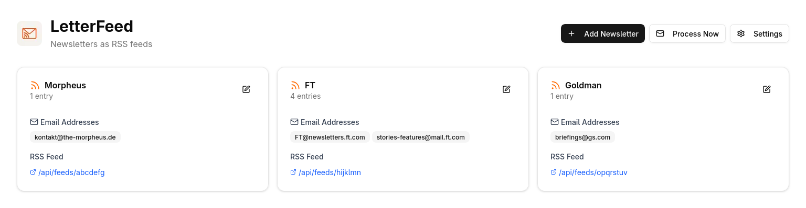

# LetterFeed

LetterFeed is a self-hosted application that transforms your email newsletters into RSS feeds.

It periodically scans your email inbox via IMAP for new emails from the senders you've configured. When it finds a new email, it processes it, and adds it as a new entry to the corresponding newsletter's RSS feed.

<div align="center">
  
</div>

## Getting Started

### Prerequisites

1. An existing mailbox with IMAP over SSL on port 993. The server's TLS certificate is verified; for a server with a self-signed certificate, set `LETTERFEED_IMAP_TLS_INSECURE=true` (this disables certificate verification).
2. Docker and Docker Compose installed on your system.

### Installation

1.  **Clone the repository:**

    ```bash
    git clone https://github.com/LeonMusCoden/letterfeed.git
    cd letterfeed
    ```

2.  **Configure environment variables:**

    Settings related to IMAP, email processing, and username/password can be set via env variables or the UI. All other settings have to be set via env vars. Settings set in the `.env` file are locked in the UI.

    ```bash
    cp .env.example .env
    ```

    Edit the `.env` file with your specific settings. All settings are explained in the `.env.example`.

3.  **Run the Docker containers:**

    ```bash
    docker compose up -d
    ```
